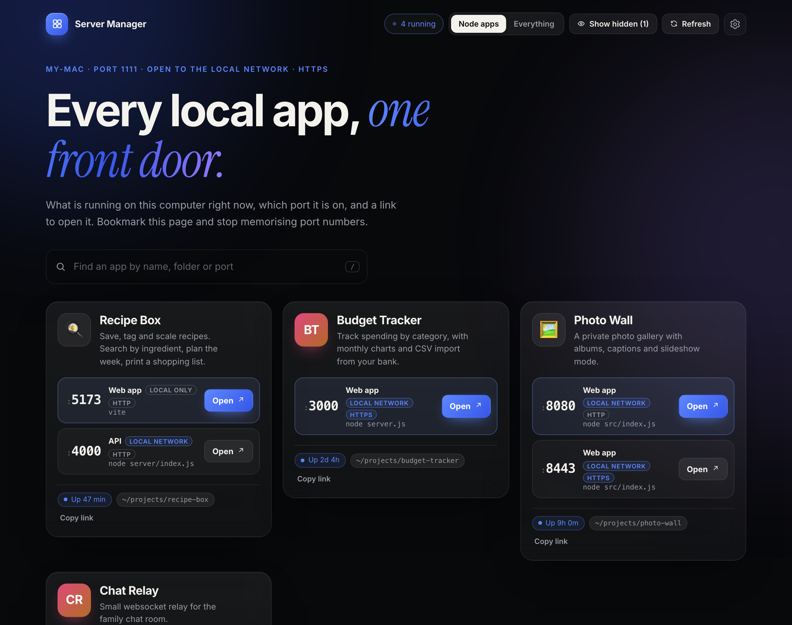
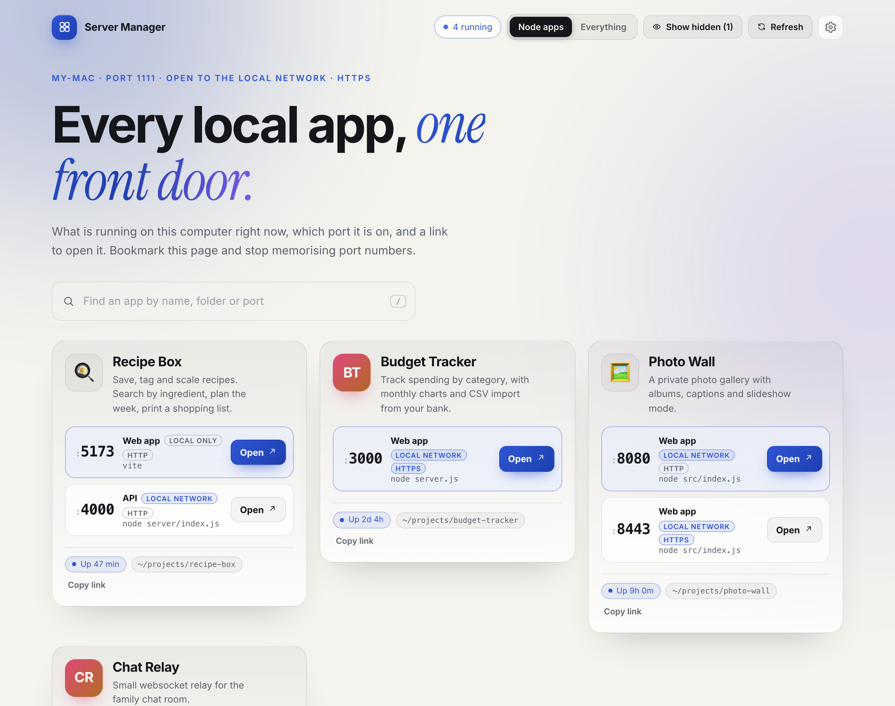
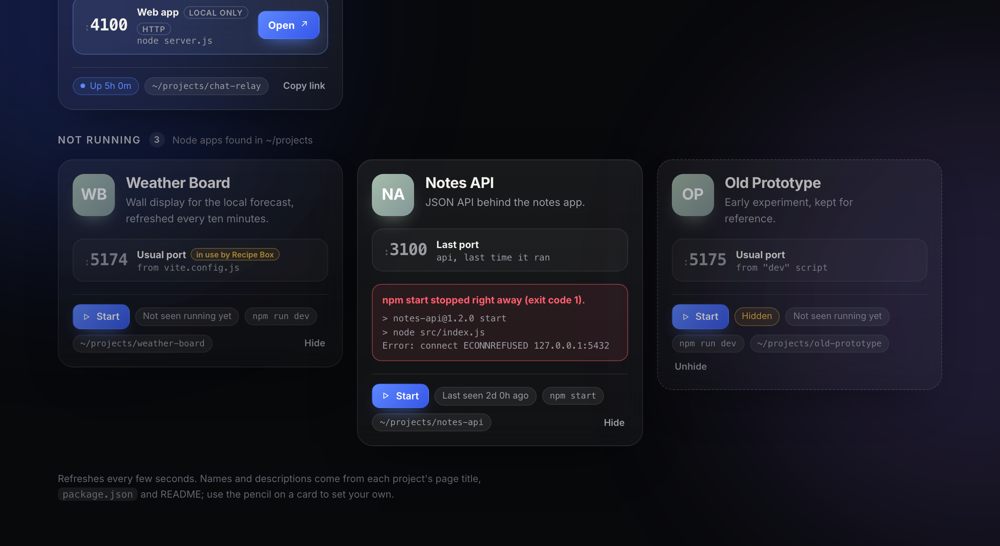
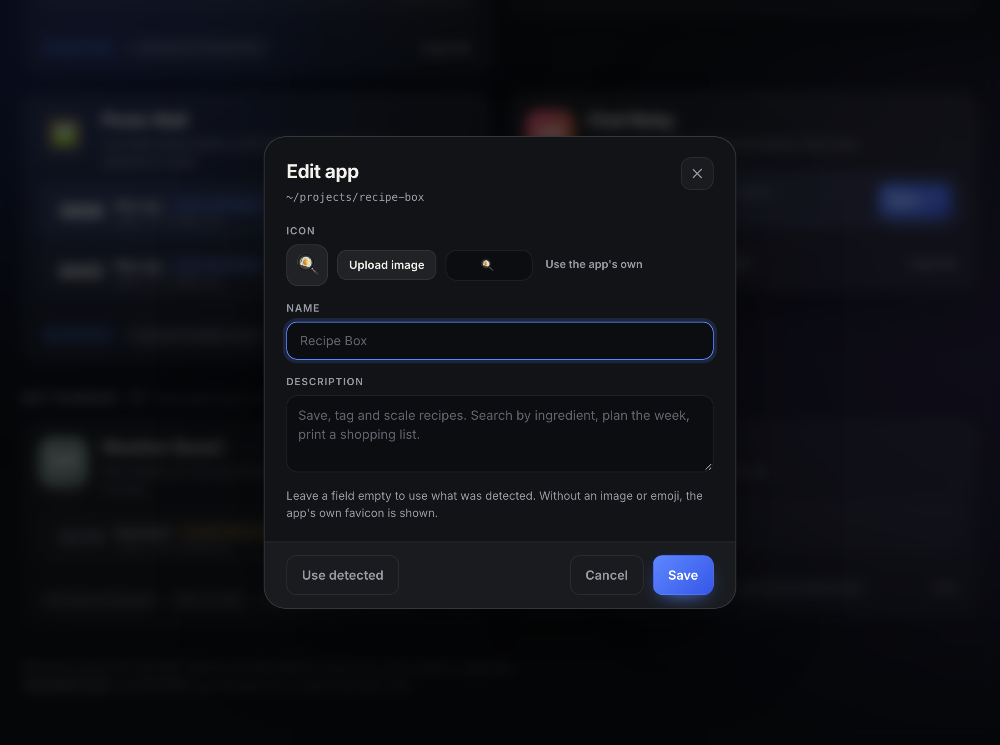
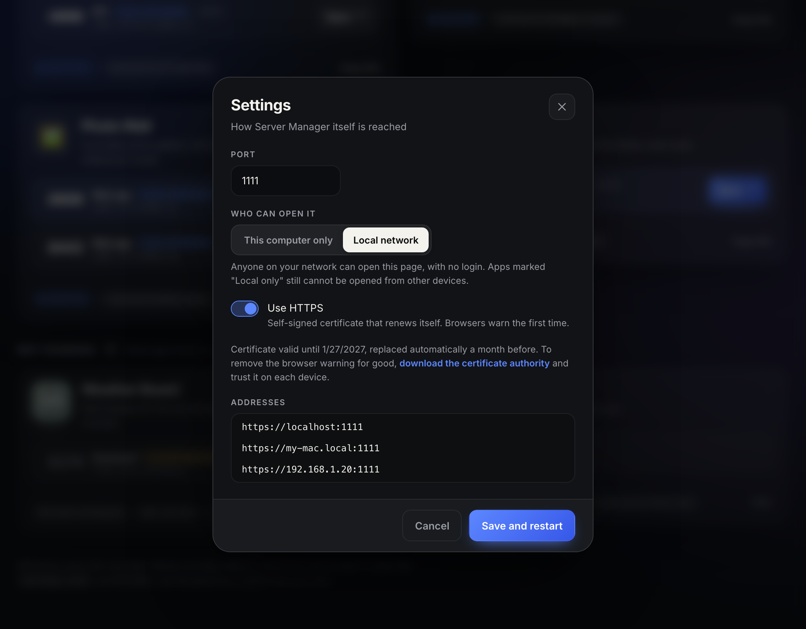

# Server Manager

The front door to every app you run locally. Server Manager shows which Node apps are running on your Mac, which port each one is on, and a link to open it, so you can stop memorising port numbers.



> The screenshots use made-up sample apps.

Pick an easy port for Server Manager itself (it defaults to **1111**), bookmark it, and start it at login. Everything else is one click away.

- **Zero dependencies.** One Node file and a few static files. No build step, no `npm install`.
- **Always current.** Rechecks every few seconds, plus a **Refresh** button for when you want to be sure.
- **Knows each app.** Name, description and icon are detected for you, and you can change them.
- **Shows how each port is exposed.** Every port is labelled **Local only** or **Local network**, and **HTTP** or **HTTPS**.
- **Remembers apps that are not running.** Node projects in your project folders are listed with the port they use and the command that starts them, with a warning when that port is taken by something else.
- **Starts them for you.** A **Start** button on those cards runs the project's `npm run dev` (or `start`), and shows the error output if it fails.
- **Optional HTTPS and network access,** with a self-signed certificate that renews itself.

## Requirements

- macOS
- Node.js 18 or newer

It reads running processes with `lsof` and `ps`, and starts at login with a macOS launch agent, so Linux and Windows are not supported.

## Quick start

```bash
git clone https://github.com/langecornu/server-manager.git
cd server-manager
node server.js
```

Open <http://localhost:1111>.

### Start at login

```bash
npm run autostart:install
```

This installs a launch agent that starts Server Manager when you log in and restarts it if it stops. Logs go to `data/server.log`.

```bash
npm run autostart:status   # installed? running?
npm run autostart:remove   # stop it and stop starting at login
```

The agent remembers the path of the `node` that installed it. If you change Node versions with a version manager, run `autostart:install` again.

After editing `server.js`, restart the agent with:

```bash
launchctl kickstart -k gui/$(id -u)/local.server-manager
```

Changes under `public/` only need a page reload.

## What you see

The page follows your system's light or dark appearance.



Each card is one app. A **running** card shows:

| | |
|---|---|
| **Name and description** | From the page title, `package.json` and the README. |
| **Icon** | The app's favicon. Without one, a coloured tile with initials. |
| **Ports** | Every port the app listens on, each with an **Open** link. The main web page is highlighted. |
| **Tags** | **Local only** or **Local network**, and **HTTP** or **HTTPS**, per port. |
| **Footer** | How long it has been up, its folder, and **Copy link**. |

Apps that are not running appear under **Not running** with the port from their config and the command that starts them. **Hide** removes one from the list, and **Show hidden** at the top brings hidden apps back.



### Starting an app

**Start** runs the command shown on the card (`npm run dev`, or `npm start` / `npm run serve` when there is no `dev` script) in that project's folder. The button shows **Starting…** until the app is listening, and then the card moves up to the running apps. If the command stops straight away, the card shows its exit code and the last lines of its output, so you can see what went wrong. The full output is kept in `data/logs/`.

- The page only sends the app's id. The command is read from that project's own `package.json` when you click, and only for projects Server Manager already lists.
- It works only from the computer Server Manager runs on, so other devices on your network never see a Start button.
- Apps run on their own, so they keep running if Server Manager restarts.
- Apps do not get Server Manager's own `PORT`, `DATA_DIR` or `npm_*` variables. They do not get the variables from your shell's startup files either (for example in `~/.zshrc`), so an app that needs one should read it from its own `.env` file.

The **Everything** switch lists every program listening on a port, not only Node apps. Press `/` to search by name, folder or port.

### Changing a name, description or icon

Use the pencil on a card. You can type a name and description, pick an emoji, or upload an image (it is shrunk to a small square before it is saved). **Use detected** puts everything back.



## Settings: port, network access and HTTPS

The gear icon opens the settings. Saving restarts Server Manager and takes you to the new address.



- **Port:** any free port from 1024 to 65535. A port that another program is using is refused.
- **Who can open it:** **This computer only** (`127.0.0.1`) or **Local network** (`0.0.0.0`). Opened from another device, the **Open** links use this Mac's network name, and apps that only listen locally have no link, because the other device could not reach them anyway.
- **Use HTTPS:** serves the page over TLS. A plain `http://` request to the same port is redirected to `https://`.

### The HTTPS certificate

The first time you turn HTTPS on, Server Manager creates a small private certificate authority (valid 10 years) and uses it to sign a certificate for `localhost`, this Mac's `.local` name and its network addresses (valid 90 days).

- The certificate is replaced automatically 30 days before it expires, and as soon as this Mac's address changes. This is checked every hour and needs no restart.
- Browsers warn the first time because the authority is your own. To remove the warning for good, download **the certificate authority** from the settings (or from `/ca.crt`) and trust it on each device. Later renewals are signed by the same authority, so they stay trusted.

## Security

Server Manager has **no login**, on purpose. Keep these in mind:

- With **Local network** on, anyone on your network can see which apps you run and on which ports. Do not expose it to the internet.
- The settings can only be changed from the computer Server Manager runs on.
- Requests are accepted only for this computer's own names and addresses, and changes are refused when they come from another website, which protects against DNS rebinding and cross-site requests.
- Everything it knows stays on your machine. It does not contact any outside service, except that the page loads its fonts from Google Fonts.
- The certificate authority's private key is stored in `data/tls/`. The `data/` folder is excluded from git. Do not share it.

## How it finds your apps

1. `lsof` lists every process listening on a TCP port, and `ps` gives each one's start time and command line.
2. A process counts as a Node app when it is `node`, `bun`, `deno`, `tsx`, `vite` and similar.
3. The process's working directory leads up to the nearest `package.json`. Ports from the same project are grouped on one card.
4. Each port is probed over HTTP (then HTTPS) to tell web pages from APIs and plain services, and to read the page title, description and favicon.
5. Your project folders are scanned for Node projects that have a `dev`, `start` or `serve` script, so apps that are not running still appear. Their usual port is read from `vite.config`, `package.json` scripts, `.env` files and the server's own code.

It only sees processes started by your own macOS user.

## Configuration

The settings dialog covers the day-to-day choices. These environment variables cover the rest:

| Variable | Default | |
|---|---|---|
| `PORT` | `1111` | Port to use when no port has been saved in the settings. |
| `SCAN_DIRS` | `~/Repo`, `~/Repos`, `~/Sites`, `~/Projects`, `~/Developer`, `~/Code`, `~/dev`, `~/src`, `~/work`, `~/git` | Folders searched for Node projects, separated by `:`. Only folders that exist are used. |
| `DATA_DIR` | `./data` | Where settings, remembered apps, uploaded icons and the certificate are stored. |

For the launch agent, set them in the generated plist, or put your folders in `data/apps.json` under `"scanDirs"`.

Files in `data/`:

| File | Contents |
|---|---|
| `settings.json` | Port, network access and HTTPS. |
| `apps.json` | Apps seen running, your custom names, descriptions and icons, and which apps are hidden. |
| `icons/` | Uploaded icons. |
| `logs/` | Output of the apps started from the page, one file per app (the last start). |
| `tls/` | The certificate authority, the server certificate and their keys. |

## Development

```bash
npm test
```

The tests start a real copy of the server in a temporary data folder and check the inventory, the request filtering, starting an app (and showing why one failed to start) and the switch to HTTPS. `openssl` must be on your path.

Server Manager's look follows the [Playlist Saver](https://github.com/langecornu/playlist-saver-app) design, in royal blue.

## License

[MIT](LICENSE)
